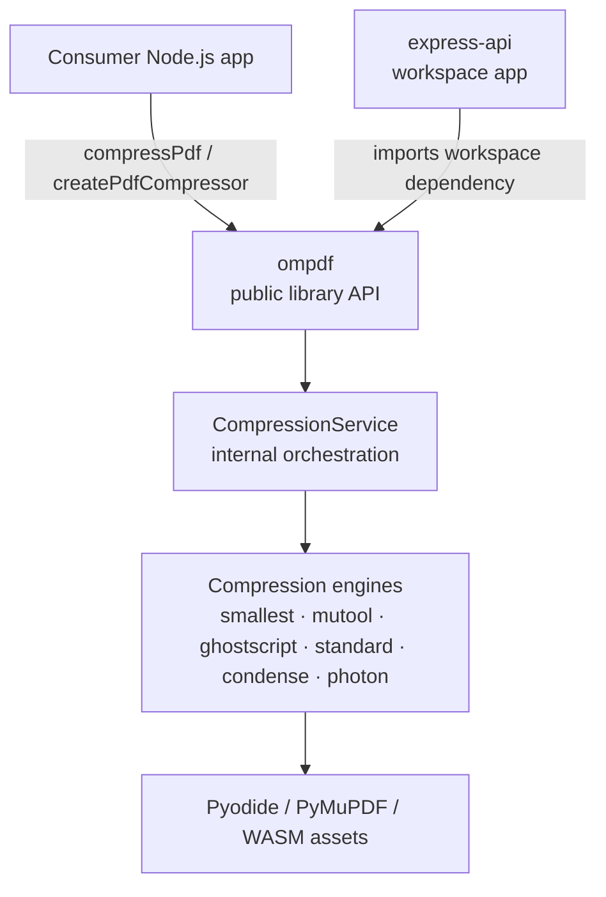
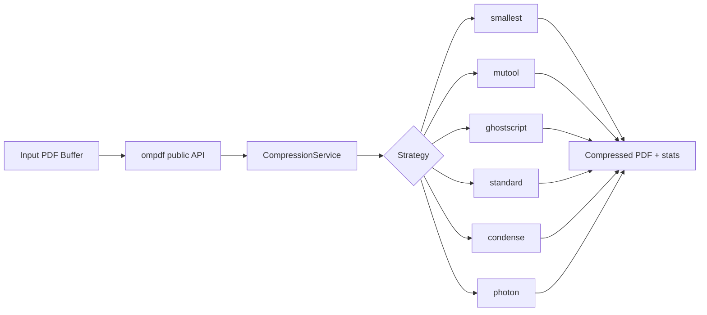

# Architecture: poc-pdf-compression monorepo

> Monorepo containing a publishable `ompdf` library package and a runnable `express-api` application.

## System context



## Repository layout

```txt
.
├── apps/
│   └── express-api/
│       ├── src/
│       └── test/
├── packages/
│   └── ompdf/
│       ├── src/
│       ├── test/
│       └── examples/
├── package.json
├── pnpm-workspace.yaml
├── turbo.json
└── tsconfig.base.json
```

## Package responsibilities

### `packages/ompdf`

Contains:

- public package exports
- compression orchestration
- engine implementations
- runtime WASM / Pyodide / PyMuPDF assets
- library unit tests
- direct-use examples

Primary public entrypoint:

```ts
import { compressPdf, createPdfCompressor } from 'ompdf';
```

### `apps/express-api`

Contains:

- Express app factory
- server entrypoint
- upload/validation middleware
- controller/router HTTP layer
- Swagger/OpenAPI config
- app-specific tests

The app depends only on public `ompdf` exports and does not import library internals directly.

## Public package surface

`ompdf` exports:

- `compressPdf`
- `createPdfCompressor`
- `PdfCompressionAlgorithm`
- `PdfCompressionQuality`
- `PdfImageFormat`
- public option/result/error types

No Express API is exported from the library package.

## Compression flow



## Testing split

### Library tests

Located in `packages/ompdf/test/**`.

Cover:

- compression service
- engine behavior
- filename utility
- runtime loader behavior
- logger behavior

### App tests

Located in `apps/express-api/test/**`.

Cover:

- HTTP validation
- request parsing
- response headers
- route behavior
- controller wiring against mocked `ompdf`

## Build and task orchestration

- pnpm workspaces manage dependencies and linking
- Turbo runs workspace tasks in dependency order
- `express-api` depends on `ompdf`
- `ompdf` build copies runtime assets into `dist/pkgs/pymupdf-wasm`

## Key design rules

- keep `ompdf` publishable and framework-agnostic
- keep Express-specific logic inside `apps/express-api`
- ensure the app uses only the library’s public surface
- keep docs/examples aligned with the package name `ompdf`
