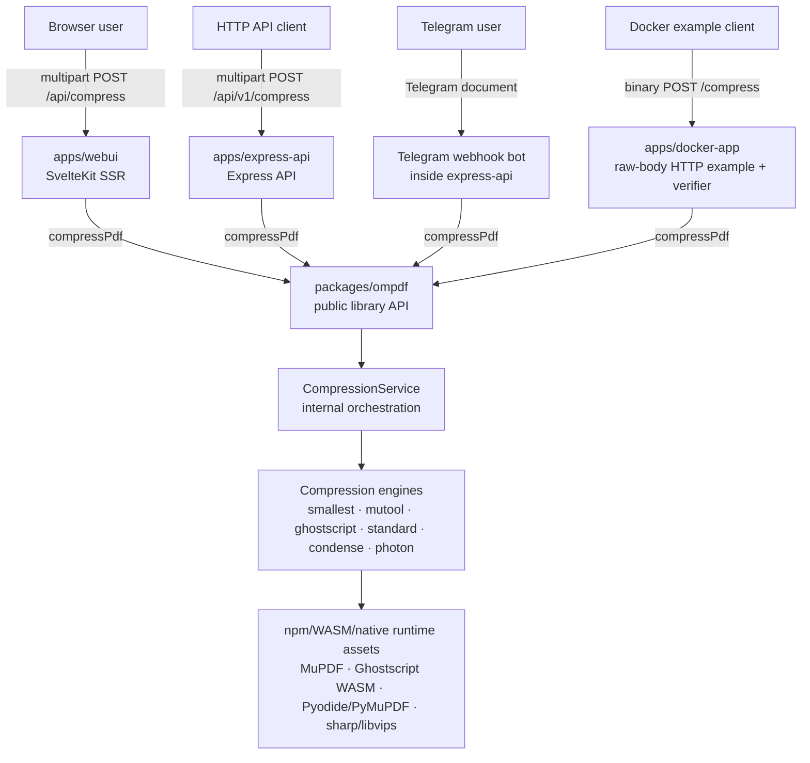
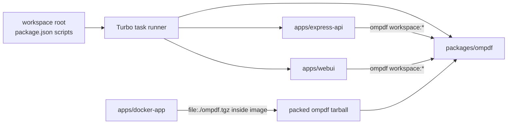
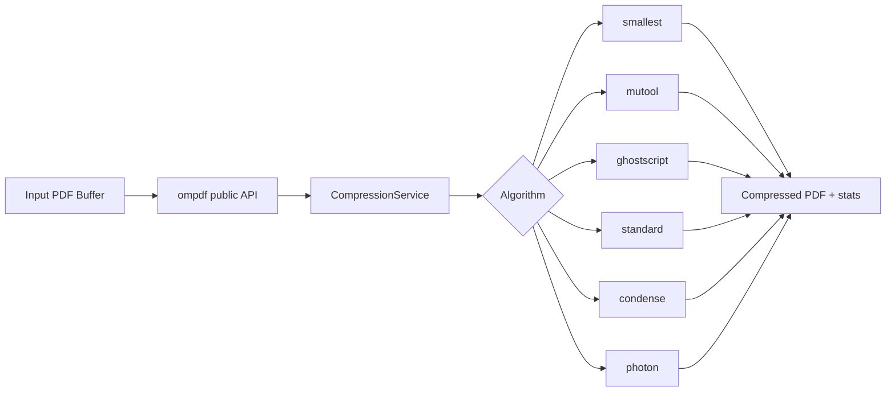
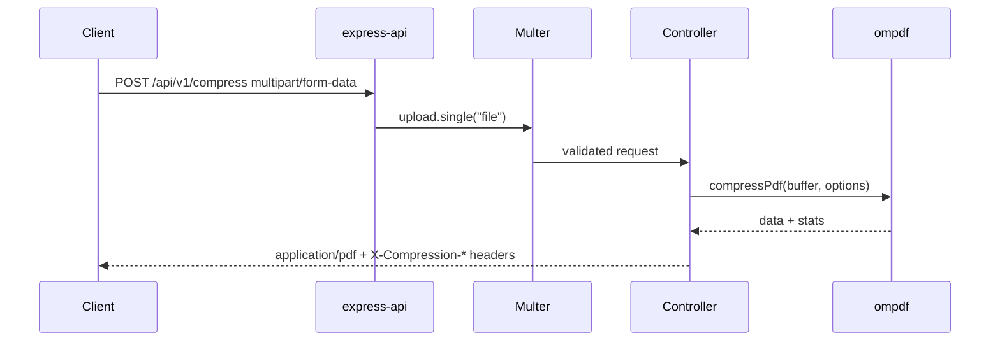
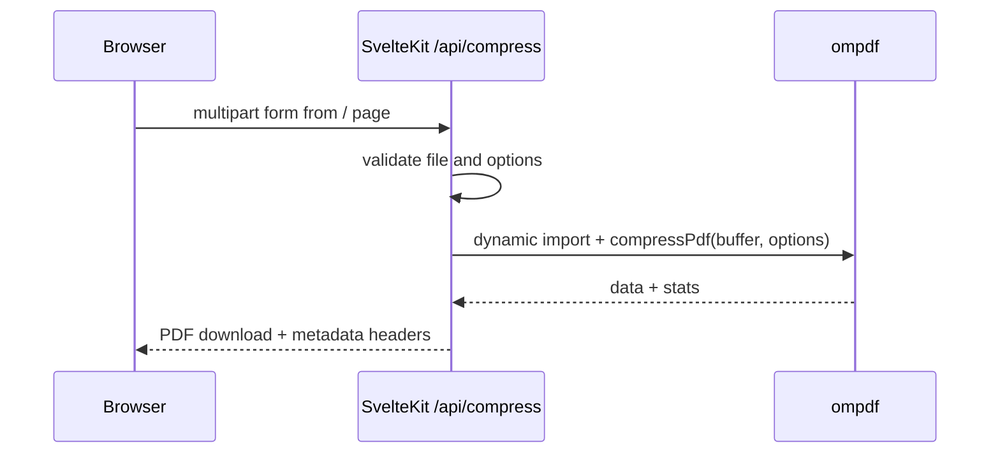

# Architecture: poc-pdf-compression monorepo

This repository is a pnpm/Turbo workspace centered on the publishable `ompdf` package. Applications consume only the package's public API:

- `apps/express-api` exposes HTTP compression endpoints and hosts the Telegram webhook bot.
- `apps/webui` provides a SvelteKit upload UI with server-side compression.
- `apps/docker-app` proves the packed package works in a clean consumer image without system PDF tools for the verified engines.

## System context



> There is no separate `apps/telegram-bot` package. Telegram support is source code under `apps/express-api/src/{routes,controllers,services,types}/telegram*` and is mounted by the Express app at `/api/v1/telegram`.

## Repository layout

```txt
.
├── apps/
│   ├── express-api/
│   │   ├── src/
│   │   │   ├── app.ts                 # Express app factory
│   │   │   ├── routes/                # /api/v1/compress and /api/v1/telegram
│   │   │   ├── controllers/
│   │   │   ├── services/              # Telegram API/client orchestration
│   │   │   └── config/                # Swagger and multer config
│   │   └── test/
│   ├── webui/
│   │   ├── src/routes/+page.svelte    # Upload form and enhanced browser UX
│   │   └── src/routes/api/compress/   # Server-only SvelteKit endpoint
│   └── docker-app/
│       ├── Dockerfile
│       ├── compose.yaml
│       ├── app.mjs                    # Minimal raw-body HTTP consumer
│       ├── verify.mjs                 # Packed-package verification
│       └── fixtures/sample.pdf
├── packages/
│   └── ompdf/
│       ├── src/
│       ├── test/
│       ├── examples/
│       └── scripts/copy-assets.mjs
├── docs/Home.md
├── package.json
├── pnpm-workspace.yaml
├── turbo.json
└── tsconfig.base.json
```

## Workspace dependencies



Root scripts delegate to Turbo:

- `corepack pnpm dev`
- `corepack pnpm build`
- `corepack pnpm typecheck`
- `corepack pnpm test`
- `corepack pnpm clean`

`pnpm-workspace.yaml` includes `apps/*` and `packages/*`, so `apps/docker-app` is part of the workspace even though it is primarily a Docker consumer example.

## Package responsibilities

### `packages/ompdf`

Contains:

- public package exports from `src/index.ts`
- compression orchestration and engine implementations in `src/pdf-compressor.ts`
- runtime asset-copying through `scripts/copy-assets.mjs`
- library unit tests in `test/**`
- direct-use examples in `examples/**`

Primary public entrypoint:

```ts
import { compressPdf, createPdfCompressor } from 'ompdf';
```

Public algorithms/options include:

- algorithms: `smallest`, `mutool`, `ghostscript`, `standard`, `condense`, `photon`
- qualities: `low`, `medium`, `high`, `maximum`
- Photon options: `dpi`, `format` (`jpeg` or `png`), `quality`
- Ghostscript options: `preset`, `compatibilityLevel`, image resolutions, and `downsampleImages`

### `apps/express-api`

Contains:

- Express app factory and server entrypoint
- upload/validation middleware
- compression controller/router mounted at `/api/v1/compress`
- Telegram webhook router mounted at `/api/v1/telegram`
- Swagger/OpenAPI setup mounted at `/api-docs` and `/api-docs.json`
- app-specific tests, including Telegram webhook/service tests

The app depends on public `ompdf` exports and does not import library internals.

### Telegram webhook bot

Telegram is an integration inside `apps/express-api`:

1. Telegram sends JSON updates to `POST /api/v1/telegram/webhook`.
2. `TelegramController` requires `TELEGRAM_WEBHOOK_SECRET` and compares it to `X-Telegram-Bot-Api-Secret-Token`.
3. The controller immediately acknowledges valid updates with `{ "ok": true }`.
4. `TelegramBotService` asynchronously downloads PDF documents using `TELEGRAM_BOT_TOKEN`.
5. The service calls `compressPdf` with the `smallest` algorithm and `medium` quality.
6. The compressed PDF is sent back to the chat with compression statistics.

Runtime configuration:

- `TELEGRAM_BOT_TOKEN` — required for Telegram API requests.
- `TELEGRAM_WEBHOOK_SECRET` — required by the webhook controller.
- `TELEGRAM_MAX_FILE_BYTES` — optional, defaults to 20 MiB.

### `apps/webui`

Contains a SvelteKit UI and a server route:

- `src/routes/+page.svelte` renders the upload form, algorithm controls, and enhanced download/stat display.
- `src/routes/api/compress/+server.ts` validates multipart form input and calls `compressPdf` on the server.

The Web UI endpoint returns a PDF with metadata headers similar to the Express endpoint, including compression algorithm, original size, compressed size, ratio, page count, and processing time.

### `apps/docker-app`

Contains:

- a Dockerfile that builds and packs `packages/ompdf`
- `verify.mjs`, which asserts common system PDF commands are absent and blocks child-process APIs
- `app.mjs`, a minimal HTTP server exposing `GET /health` and `POST /compress?algorithm=...`

The verification currently covers `standard`, `condense`, `mutool`, and `ghostscript`. Photon is intentionally documented as not part of the passing isolated-package proof because the packaged Pyodide runtime currently fails to load `micropip` in that consumer image.

## Compression flows

### Library call



### Express multipart request



### Web UI request



## Runtime assets and packaging

`packages/ompdf/package.json` publishes only `dist`, `README.md`, and `LICENSE`. The library build runs:

```bash
tsc -p tsconfig.json && node scripts/copy-assets.mjs
```

The asset-copy step is part of making runtime WASM/Pyodide assets available from the built package. The Docker example is the consumer-level packaging check for this behavior.

Important runtime note: the repository does not require system `gs`, `mutool`, or Python executables for the verified Docker engines. Some dependencies still carry their own runtimes, for example `sharp` uses npm-provided native bindings and libvips.

## Testing split

### Library tests

Located in `packages/ompdf/test/**`. They cover compression behavior, utilities, runtime loading, and logging.

Run with:

```bash
corepack pnpm --filter ompdf test
```

### Express API tests

Located in `apps/express-api/test/**`. They cover request validation, headers, route behavior, controller wiring, and Telegram webhook/service behavior.

Run with:

```bash
corepack pnpm --filter express-api test
```

### Web UI tests/checks

The `webui` workspace defines `typecheck`, `build`, and `test` scripts. Run with:

```bash
corepack pnpm --filter webui typecheck
corepack pnpm --filter webui test
```

## Key design rules

- Keep `ompdf` publishable and framework-agnostic.
- Keep Express-specific and Telegram-specific logic inside `apps/express-api`.
- Keep browser UI logic in `apps/webui`; run compression only on the SvelteKit server.
- Keep Docker dependency-proof code isolated in `apps/docker-app`.
- Applications must consume only the library's public `ompdf` surface.
- Keep documented commands, endpoints, and environment variables aligned with manifests and source.
